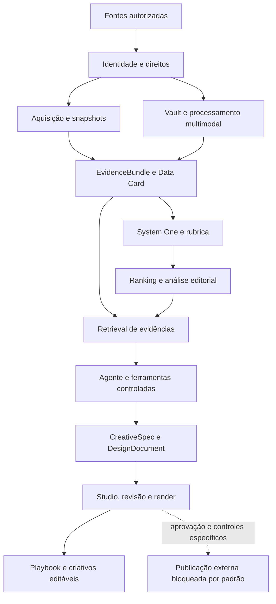

# TAPI Stone | Inteligência de conteúdo para pequenos negócios

**Stone × Inteli Academy** — Pesquisa aplicada, inteligência editorial e criação de conteúdo orientada por evidências.

O TAPI Stone investiga quais características de conteúdo, formato e criador estão associadas ao alto engajamento de publicações dirigidas a micro e pequenas empresas (MPEs). O projeto transforma essas observações em recomendações rastreáveis, propostas editoriais e criativos editáveis, apoiando a comunicação da Stone e o desenvolvimento de um playbook educativo para empreendedores.

**Estado:** desenvolvimento consolidado na `main` em 24/11/2026, com demonstração local e evidências técnicas parciais. **Não homologado para produção nem validado cientificamente de forma independente.**

[Executar a demonstração](#execução-local) · [Arquitetura](#arquitetura) · [Metodologia](#metodologia) · [Resultados e limitações](#resultados-e-limitações) · [Documentação](#documentação)

## O que a plataforma faz

| Frente | Funcionalidades presentes no desenvolvimento |
|---|---|
| Aquisição e governança | Fontes, snapshots de métricas, checkpoints, identidade, grants e rastreabilidade de operações autorizadas. |
| Inteligência multimodal | Registro de ativos, processamento local de áudio/transcrição, OCR, frames e candidatos de fusão com abstenção por falta de evidência. |
| Análise editorial | Ranking por engajamento, top decil, rubrica de 20 campos, comparação top/restante e hipóteses exploratórias. |
| Recuperação de evidências e agente | Busca textual, referências verificáveis, ledger de checkpoints e propostas locais; modos analisar, recomendar e gerar_criativo são o contrato alvo, não uma garantia de autonomia integral. |
| Creative Studio | Documentos editáveis, carrosséis, versões, storyboards, exportações e renderização local de vídeo; direitos vinculados à operação e à versão. |
| Demonstração | Painel de pesquisa, jornada interativa, biblioteca persistente opcional, pares A/B e composição de Reels com narração sintética opcional. |

A entrega final prevista inclui base documentada, mapeamento editorial, agente, playbook com pelo menos cinco propostas originais, demonstração e documentação reprodutível. O escopo ampliado do Studio não substitui esses entregáveis. Publicação externa, anúncios, CRM e recursos faturáveis não são habilitados pela demonstração.

## Arquitetura

O desenho alvo combina um monólito modular, workers locais isolados e contratos comuns. A jornada abaixo é conceitual; não representa serviços implantados ou capacidades homologadas.



| Camada | Base tecnológica encontrada |
|---|---|
| Aplicação e contratos | Python 3.11+, FastAPI, Pydantic |
| Persistência e identidade | SQLAlchemy, Alembic, SQLite local, Argon2id; PostgreSQL como opção a validar operacionalmente |
| Interface | HTML, CSS e JavaScript locais |
| Multimodal | FFmpeg, Pillow, OpenCV; adaptadores locais de OCR, ASR/VAD e VLM condicionados aos pré-requisitos |
| Recuperação e agente | SQL/FTS5, ledger SQL; LangGraph, modelos e estratégias alternativas em avaliação |
| Studio | Editor em camadas, revisões, render local FFmpeg |
| Qualidade | pytest, verificadores locais de sintaxe, direitos, documentação e custo zero |

A escolha definitiva de modelos, infraestrutura e orquestração depende dos critérios e benchmarks vigentes. Consulte a [arquitetura unificada](docs/base_atemporal/07_Arquitetura_Unificada_Atemporal.md), o [System One](docs/base_atemporal/06_SystemOne_StoneS1_Atemporal.md) e o [mapa arquitetural](docs/architecture/README.md).

## Metodologia

A pesquisa é observacional: associações entre características e engajamento não demonstram causalidade.

- **População:** conteúdo dirigido a MPEs, independentemente do porte econômico de quem publica. A referência planejada é de 2.000–5.000 posts, 30+ perfis e publicações com idade de pelo menos 14 dias; não é uma contagem alcançada nem garantia de representatividade.
- **Universos separados:** C1 (corpus externo), C2 (Instagram próprio Stone), C3 (anúncios históricos) e C4 (contexto editorial). Não misturar denominadores, métricas ou finalidades.
- **Engajamento:** ER = (curtidas + comentários) / seguidores observados; excluir valores ausentes e denominadores inválidos. Comparar top 10% e restante por coorte, janela, cobertura e critérios de desempate.
- **Rubrica:** 20 atributos de formato, gancho, tema, linguagem, prova social, ritmo, CTA e outros elementos. Preservar proveniência, distinguir desconhecido de ausência e abster quando a modalidade necessária não estiver disponível.
- **Recomendação:** vincular hipóteses e propostas originais a evidências verificáveis, sem copiar conteúdo de terceiros, inferir conversões por proxies ou tratar rótulos de modelos como gold independente.

A [metodologia científica](docs/base_atemporal/05_Metodologia_Cientifica_Atemporal.md) e o [documento mestre](docs/base_atemporal/01_Documento_Mestre_Atemporal.md) preservam os detalhes e oráculos. A [DEC-018](docs/53_DEC018_CONFIRMACAO_ALCANCE_E_CRITERIO_REVISAO_2026-11-05.md) registra a dispensa comunicada da revisão humana independente original: IMP-062 dispensado, não cumprido; não alegar validação independente.

## Execução local

### 1. Preparar o ambiente

Use um checkout limpo da main e Python 3.11+ (preferencialmente o ambiente do projeto já configurado). Em ambiente novo e autorizado, as dependências Python básicas e opcionais abaixo estão declaradas em [pyproject.toml](pyproject.toml). Instalar apenas se necessário, sem contratar serviços ou baixar modelos automaticamente.

```powershell
git status --short
git rev-parse HEAD
$env:PYTHONPATH = Join-Path (Get-Location).Path "src"
# Apenas se as dependências ainda não estiverem instaladas:
python -m pip install -e ".[dev,local_render,rights_local]"
```

A demonstração usa banco SQLite próprio; não configure credenciais Meta nem aponte para o banco operacional. Para vídeo, FFmpeg deve estar disponível no PATH. Modelos nativos, GPU e serviços externos não são necessários para a demonstração sintética básica.

### 2. Iniciar a demonstração

```powershell
python -m scripts.demo_stone
```

Abra [http://127.0.0.1:8765/app/demo.html](http://127.0.0.1:8765/app/demo.html). Organização: `stone-demo`; usuário: `demo`; senha local de pelo menos 12 caracteres escolhida no terminal. O servidor escuta apenas loopback. O modo padrão usa dados fictícios e banco temporário, descartado ao encerrar; exporte os rascunhos antes de sair.

**Vídeo e workspace persistente (opcionais):**

```powershell
$workspace = Join-Path $env:USERPROFILE "Documents\Stone-Apresentacao"
python -m scripts.demo_stone --video --workspace "$workspace"
```

Use pasta nova exclusiva ou workspace de demonstração existente, nunca banco operacional. Ao reabrir, mantenha a senha original e os mesmos relatórios de entrada, se usados. O modo `--video` exige FFmpeg e confirmação de direitos dos ativos locais originais na interface. Não publica conteúdo.

Os parâmetros opcionais `--technical-report` e `--av-report` recebem arquivos locais já existentes e autorizados; a interface mantém os agregados históricos e a evidência sintética separados do ranking fictício da sessão. Não enviar relatórios privados ou workspaces ao Git.

### 3. Explorar a jornada

1. Consulte ranking, rubrica e referências na demonstração.
2. Explore análise, propostas locais e hipóteses editoriais quando houver relatório histórico compatível.
3. Crie ou recupere um rascunho, edite e exporte; para vídeo, selecione um preset e confirme direitos aplicáveis.
4. Opcionalmente, gere narração pt-BR com roteiro exportado, eSpeak/eSpeak NG e FFmpeg locais, conforme o [guia Kinetic v4](docs/133_DEMO_SOCIAL_KINETIC_2026-11-24.md).

Mais detalhes: [demonstração](docs/118_DEMO_VISUAL_48H_2026-11-23.md), [workspace](docs/126_DEMO_PERSISTENT_WORKSPACE_2026-11-24.md) e [render](docs/121_DEMO_VIDEO_RENDER_2026-11-23.md). Os registros são datados; não seguir comandos de troca para branches antigas.

### 4. Verificar o desenvolvimento

```powershell
python docs/base_atemporal/ferramentas/validar_espelho.py
python scripts/documentation_catalog.py check
python -m pytest -q tests/test_documentation_catalog.py
python scripts/verify_zero_spend.py
python -m scripts.a05_python_source_preflight
```

Testes focais de demonstração, com dependências locais previamente preparadas:

```powershell
python -m pytest -q tests/test_demo_stone.py tests/test_demo_workspace.py
python -m pytest -q tests/test_demo_social_motion.py tests/test_demo_reel_narration.py tests/test_demo_social_reel.py
```

A regressão integral (`python -m pytest -q -rs --tb=short`) depende dos pré-requisitos nativos pertinentes. Consultar o preflight e os protocolos A00/A11 antes de executar; registrar FAIL e SKIP. Não migrar banco operacional nem liberar acesso externo durante testes.

## Resultados e limitações

Evidências selecionadas, preservadas com seus contextos originais. **Não somar lotes sobrepostos nem atribuir resultados históricos ao HEAD atual.**

| Evidência | Resultado registrado | Limite |
|---|---|---|
| [Retrieval local, 20/11](docs/75_IMP071_EVIDENCIA_FASTPATH_E_LACUNAS_DE_ACEITE_2026-11-20.md) | 1.069 conteúdos técnicos, 27 fontes, três consultas, mediana batch 716,7 ms | Recorte técnico; sem ground truth independente ou SLO de produção. |
| [Jornada sintética, 23/11](docs/118_DEMO_VISUAL_48H_2026-11-23.md) | 20 posts fictícios, quatro perfis, dois no top decil, cinco propostas e exportações | Demonstração funcional com dados fictícios; não resultado do corpus real. |
| [Regressão nativa, 23/11](docs/109_A027_SHARED_AV_STRICT_WER_CONTRACT_2026-11-23.md) | 2.144 PASS, 2 FAIL, 2 SKIP no SHA anterior indicado | Correção posterior do contrato de teste não comprova melhora de WER. |
| [Kinetic v4, 24/11](docs/133_DEMO_SOCIAL_KINETIC_2026-11-24.md) | Exemplos locais de MP4 1080 × 1920, 30 fps, 15 s e narração opcional | Composição candidata; exemplos do encoder direto não equivalem à validação integral da fila/browser. |
| [Consolidação documental, 24/11](docs/governance/CONSOLIDATION_2026-11-24.md) | 32 blobs preservados, 625 nós, 7.181 relações com proveniência e 5 testes documentais PASS reportados no SHA #99 | Validação estrutural, não auditoria semântica nem regressão integral. |

Limites principais: representatividade e elegibilidade científica do corpus não comprovadas; ausência de revisão humana independente; qualidade multimodal dependente de cobertura e modelos; decisão DEC-008 e paridade nativa ainda sujeitas a evidências; regressão e gates globais no HEAD final não demonstrados. Nenhuma métrica de engajamento prova lead, venda ou eficácia de um criativo.

## Organização do repositório

| Caminho | Responsabilidade |
|---|---|
| [src/tapi_gate0/](src/tapi_gate0/) | Aplicação, domínio, políticas, agentes, multimodal e Studio |
| [scripts/](scripts/) | Demonstração, operação autorizada e verificadores locais |
| [tests/](tests/) | Testes de contrato, integração, segurança e regressão |
| [migrations/](migrations/) | Evolução versionada do banco |
| [contracts/](contracts/) | Artefatos OpenAPI versionados; conferir versão com código |
| [config/](config/) | Políticas e configurações sem credenciais |
| [planning/base_atemporal/](planning/base_atemporal/) | Plano Único, matrizes de requisitos, capacidades, decisões e testes |
| [docs/](docs/) | Documentação, arquitetura, governança e histórico |
| [evidence/](evidence/) | Evidências e fixtures permitidas no repositório; não armazenar material privado |

## Documentação

- [Portal documental](docs/README.md) — navegação por objetivo.
- [Base Atemporal v6.1 e integração](docs/base_atemporal/INTEGRACAO.md) — fontes canônicas, precedência e remissões ao pacote privado integral.
- [Plano Único](docs/base_atemporal/11_Plano_Unico_Atemporal.md) — 204 IMP, 543 dependências, 23 CAP e aceite único IMP-131.
- [Padrão documental](docs/governance/STANDARD.md), [templates](docs/governance/TEMPLATES.md) e [catálogo histórico](docs/governance/CATALOG_2026-11-24.md).
- [Consolidação da main](docs/governance/CONSOLIDATION_2026-11-24.md), [fluxo de desenvolvimento](docs/REPOSITORY_WORKFLOW.md) e [AGENTS.md](AGENTS.md).

## Segurança, evolução e aceite

O orçamento financeiro é **R$ 0**. A aprovação institucional comunicada na DEC-018 não substitui credenciais, direitos por conta/ativo/operação, grants revogáveis, segregação de tenant, quotas ou controles de segurança. Não registrar segredos, dados privados ou mídia restrita no Git.

O desenvolvimento parte da main e segue o Plano Único: completar a arquitetura, reconciliar contratos e evidências, validar a jornada ponta a ponta e cumprir os oráculos aplicáveis antes de homologar. G0–G6 e IMP-131 não são liberados pelo merge, por esta documentação ou pela demonstração. Consultar o [registro de consolidação](docs/governance/CONSOLIDATION_2026-11-24.md) e a evidência do SHA vigente antes de qualquer operação.

O [README histórico anterior à reorganização](https://github.com/pablo-marchina/stone/blob/4622d0171c8b1ea72f7c892c77fd7118fd12ae5e/README.md) permanece disponível para auditoria.
