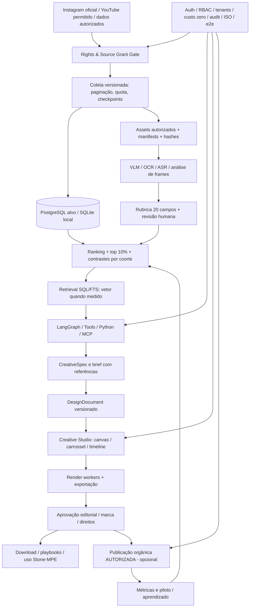

# TAPI Stone × Inteli Academy — Arquitetura Unificada Revisada v5.2

**Revisão arquitetural e registro de alterações (v5.1 → v5.2)**  
**Data de consolidação documental:** 30/10/2026  
**Status:** **REVISÃO DOCUMENTAL PROPOSTA, REGISTRADA — não homologada como baseline de execução nem implementada integralmente.**  
**Produto:** plataforma única de inteligência, pesquisa, geração, edição e operação de conteúdo para Stone/Impulso Stone e micro e pequenos empreendedores (MPEs).  
**Entrega:** uma entrega final consolidada; os marcos e gates abaixo são verificações internas, não novas entregas.  
**Orçamento:** **R$ 0 em desembolsos e serviços faturáveis**; infraestrutura local utiliza recursos físicos e exige verificação de capacidade.  
**Referência do case:** Aula 1, kickoff identificado como 28/10/2026 e entrega presencial indicada para 25/11/2026.

> **Como ler este documento.** **[BASE]** = requisito ou decisão já registrado na arquitetura v5.1 e matrizes; **[AULA]** = informação expressa na Aula 1; **[REPO]** = capacidade inspecionada na branch `main`; **[MUDANÇA v5.2]** = proposta arquitetural incluída nesta revisão; **[PENDENTE]** = ainda não implementado, autorizado, testado ou incorporado às matrizes oficiais. Esta distinção impede confundir cobertura planejada, alteração de documentação e funcionalidade entregue.
>
> **Limite da comparação:** o arquivo narrativo integral da v5.1 não estava disponível para diff textual completo nesta revisão. A comparação foi feita com as **matrizes oficiais locais do Plano Único**, a metodologia revisada, o Documento Mestre, a pesquisa/benchmark, a Aula 1, a análise transversal anterior, o documento `docs/22_STUDIO_CRIATIVO_EDITAVEL_E_STACK_ALVO.md` e trechos concretos da `main`. Não se afirmam mudanças linha a linha na narrativa v5.1 não verificada.

---

## 1. Sumário executivo

**Decisão de arquitetura proposta:** preservar o **monólito modular + workers especializados + APIs tipadas + eventos duráveis**, e evoluir a jornada central para:

**Pesquisa rastreável → evidência quantitativa/multimodal → agente fundamentado → criativo editorial → publicação visual ou audiovisual estruturada e editável → aprovação/exportação → eventual publicação orgânica autorizada → avaliação e aprendizado.**

A inovação principal é **CAP-023 — Creative Studio editável**, que complementa a CAP-016 (produção final de imagem/vídeo), sem substituí-la. O usuário poderá transformar um roteiro em composição visual, ajustar suas camadas, cenas, textos, cores, imagens e outros elementos, salvar versões, exportar e aprovar. O projeto editável — **não a imagem achatada** — será a fonte canônica.

**Não mudam:** os seis entregáveis institucionais, as 22 capacidades anteriores, os 18 requisitos, os sete gates globais, os 12 registros de decisão existentes e as 162 tarefas do plano original. **CAP-023, DEC-013–015 e IMP-163+ são propostas de adição**, ainda **não inseridas** nos CSVs oficiais. As futuras modificações estruturadas deverão ser atômicas, com validação de integridade e rastreabilidade; jamais reenumerar ou apagar identificadores existentes.

**Resultado da revisão:** especificação arquitetural aprofundada e log de mudanças. **Não** há novo editor implementado, nova coleta real executada, corpus validado ou licenciamento de plataformas externas.

## 2. Inventário baseline: aquilo que está sendo preservado

| Artefato da v5.1 | Quantidade conferida | Regra desta revisão |
|---|---:|---|
| Capacidades CAP-001…CAP-022 | 22 | Manter IDs, categorias e intenção; acrescentar CAP-023 **proposta** |
| Requisitos U01…U18 | 18 | Preservar; associar CAP-023 principalmente a U02/U04/U06/U08/U09/U10/U11/U13/U14/U17/U18 conforme revisão da matriz |
| Decisões DEC-001…DEC-012 | 12 | Permanecem abertas quando ainda requerem benchmark |
| Grupos de domínio | 16 | Estender entidades em grupos existentes; novo grupo só se evidência de necessidade |
| Tarefas IMP-001…IMP-162 | 162 | Preservar Plano Único, ordem e critério de entrega única |
| Matriz ISO 22×9 | 198 associações | Extensão planejada a **23×9 = 207** associações, sem afirmar que a matriz já foi alterada |
| Gates de liberação G0…G6 | 7 | Preservar, estendendo aceites pertinentes ao novo editor |

**Categorias originais:** 7 capacidades formais (`CAP-001…007`), 7 opcionais (`CAP-008…014`), 5 fora do escopo do case (`CAP-015…019`) e 3 transversais (`CAP-020…022`). A proposta CAP-023 é **expansão adicional autorizada pelo responsável**, não obrigação institucional anunciada pela Stone.

### 2.1 Capacidade existente ≠ capacidade pronta

**[REPO]** Implementado e testado localmente: contratos de domínio/Pydantic, backend FastAPI, SQLite/Alembic, autenticação/RBAC local e multi-tenant, eventos/outbox/SSE, UI autenticada e adaptadores de **metadados oficiais** com bloqueio por padrão, grants e controle administrativo de custo. A rubrica atual classifica apenas algumas evidências de metadados/legenda, com inspeção local preliminar de mídia autorizada. Há estrutura para ranking/linhagem em fluxos locais/sintéticos.

**[PENDENTE]** A conexão oficial Meta ainda está em onboarding; nenhum token válido foi conectado à aplicação e não há coleta externa real comprovada. Também faltam corpus ≥2.000 posts/≥30 perfis, validação humana ≥50, análise multimodal completa, agente LangGraph/MCP final, playbook completo, cinco criativos fundamentados, Creative Studio e produção/publicação externa. O estado `NAO_IMPLEMENTADO` nas matrizes originais é um **snapshot histórico de planejamento**, não substitui inspeção atual do código; não sobrescrever sem auditoria por capacidade e evidência.

---

## 3. Histórico das alterações: v5.1 → v5.2

**Legenda:** `REGISTRADO` = efetivamente introduzido **neste documento**; `ESPECIFICADO` = solução arquitetural aprofundada, mas não codificada; `PENDENTE` = implantação ou alteração dos CSVs oficiais ainda não realizada.

| ID | Alteração arquitetural | Origem e motivação | Impacto | Situação |
|---|---|---|---|---|
| A-01 | Jornada passa a integrar **prévia visual editável** entre criativo e exportação | Solicitação do responsável | CAP-007/016/022, **CAP-023** | REGISTRADO; software pendente |
| A-02 | Introduz `CreativeSpec → DesignDocument` versionado, com páginas/camadas/cenas | Edição livre sem regenerar bitmap | Contratos, domínio, armazenamento | ESPECIFICADO |
| A-03 | Separação de **evidência**, **hipótese editorial**, **criativo** e **documento visual** | Preservar auditabilidade diante de edições | Linhagem/qualidade/agent | REGISTRADO |
| A-04 | Editor manual + sugestões de IA em **patches propostos**, com aprovação | Controle do usuário, segurança e rastreabilidade | UX, agent, versões | ESPECIFICADO |
| A-05 | Exportação de imagens/carrossel e pipeline separado de render de vídeo | Preview ≠ arquivo final | Workers, filas, assets | ESPECIFICADO |
| A-06 | Conciliação do **case com todos os extras** sem eliminar obrigações | Aula 1: seis entregáveis, três níveis, cinco extensões | CAP-001…023 e produto | REGISTRADO |
| A-07 | Experiência única com visões **Stone/analista** e **lojista/empreendedor** | Dois públicos do case | UI, RBAC, playbook | ESPECIFICADO |
| A-08 | Reforço da aquisição: **paginações/cursor**, idade ≥14 dias, snapshots, refresh e cobertura por estrato | Auditoria do código × Aula 1 | CAP-001, DEC-005 | REGISTRADO; código pendente |
| A-09 | Estatística: top 10% com **contraste contra restante**, coortes, IC e limites de inferência | Evitar achados espúrios | CAP-002/008, U03 | ESPECIFICADO |
| A-10 | Rubrica com **evidência por campo**, revisão humana e abstenção | Qualidade das 20 categorias | CAP-003/004 | Mantido/reforçado |
| A-11 | Agente e MCP ligados à prova original, com revisão de **versões do SDK** | Aula 1 e atualização do MCP | CAP-005/006, DEC-008 | ESPECIFICADO |
| A-12 | Embaixador, collab e piloto orgânico explicitados como fluxo operacional | Cinco maneiras de ir além | CAP-010/014/017/019 | ESPECIFICADO |
| A-13 | Stack candidata inclui **editor canvas, texto rico, timeline/render e IA local** | Novo escopo de criação | DEC-002/007/008/010 e DEC-013…015 | ESPECIFICADO; benchmark pendente |
| A-14 | Direitos de assets, imagem, música, fontes, marcas e propriedade das versões | Segurança, direitos e custo | G0/G1/G4, domínio | ESPECIFICADO |
| A-15 | Testes adicionais: **edição real, persistência, preview/export, acessibilidade, direitos, tenancy e custo** | EDD/ISO 25010/25019 | Qualidade/novos CT | REGISTRADO; testes pendentes |
| A-16 | Limite de zero reais explícito para mídia paga; recursos de anúncios não executam gasto | Solicitação do responsável | CAP-018, DEC-012 | Mantido/reforçado |
| A-17 | Publicação orgânica continua ação separada, autorizada e revisada | Não confundir preview com postagem | CAP-017, G0/G6 | Mantido/reforçado |
| A-18 | Atualização do Plano Único proposta, **sem criar backlog paralelo** | Consistência de referência | 23×9, novos CT, CAP-023, IMP-163+ | **PENDENTE nos CSVs** |

**Alterações já feitas de fato antes desta revisão:** o documento de proposta `docs/22_STUDIO_CRIATIVO_EDITAVEL_E_STACK_ALVO.md` foi incorporado à `main` pelo PR #7; issue #8 acompanha CAP-023. **Alteração feita nesta revisão:** este documento v5.2 detalha e organiza as consequências arquiteturais. **Não se altera automaticamente o comportamento do produto apenas com a documentação.**

---

## 4. Aderência obrigatória ao case da Aula 1

**[AULA] Requisitos de referência:** amostra alvo de **2.000–5.000 posts de 30+ perfis, com 14+ dias de publicação**; ranking **`(curtidas + comentários)/seguidores`**, com corte no **top 10%**; rubrica de **20 campos**; validação manual de **pelo menos 50 posts**; agente com referência por resposta; **Python + MCP**; playbook com **mínimo de cinco criativos**; demonstração executável e README. Para os vídeos, o nível recomendado inclui frames e transcrição. O nível avançado soma contraste top/resto, RAG e comentários. O material recomenda embaixador, collab, piloto, playbook do lojista e painel interativo.

| Entregável institucional | Capacidades diretamente relacionadas | Evidência de aceite da v5.2 | Estado atual |
|---|---|---|---|
| Base documentada | CAP-001 | data card, fontes, licenças, idades, diversidade por criador, contagens, duplicatas, lacunas | **Não concluído** em dados reais |
| Mapeamento | CAP-002/003/004/008/011/012 | ranking reexecutável, percentis, 20 campos, amostra ≥50 validada, padrões e casos em destaque | **Não validado empiricamente** |
| Agente | CAP-005/006/009 | função Python, ferramentas MCP, três modos, referências e explicação sem fontes inventadas | **Não concluído** |
| Playbook | CAP-007/010/014/016/**023** | cinco peças editoriais prontas para trabalho, arquivos editáveis opcionais v5.2, fontes e aprovação | **Não concluído** |
| Demonstração | CAP-005/006/022/**023** | fluxo real: consulta → evidência → brief → design editável → exportação; respostas não simuladas | **Não concluído** |
| README | Transversal | métodos, scripts, limites, resultados observados, modelos, versões e direitos | **Parcial** (documentação de engenharia) |

**Não reduzir o aceite institucional à nova funcionalidade visual.** Um editor impressionante não substitui o corpus representativo, as análises ou a validação da rubrica. Os extras só podem ser declarados prontos mediante provas próprias.

---

## 5. Visão lógica da arquitetura revisada



**Estrutura de deploy-alvo:** monólito modular FastAPI com API de leitura/escrita e RBAC, banco transacional, workers assíncronos diferenciados (ingestão/IA/render), frontend React+TypeScript e armazenamento local privado de assets. Eventos/outbox e SSE permanecem o mecanismo de atualização live já iniciado no repositório. **Não** presumir necessidade de Kubernetes, Redis, três bancos ou múltiplos agentes antes de benchmark. Colaboração simultânea (Yjs/WebSocket) é uma extensão condicional de edição, não dependência do editor inicial.

### 5.1 Limites entre módulos

1. **Acquisition & Compliance:** identidade das fontes, escopos OAuth, direitos, quotas, retenção, cursor e origem.
2. **Data & Research:** snapshots de métricas, amostragem, ranking, estimativas, inferência não causal e experimentos.
3. **Multimodal Evidence:** análise de mídia permitida, transcrição, 20 campos, revisões humanas e grau de observabilidade.
4. **Retrieval & Agent:** busca e ferramentas de análise, três modos, versões dos prompts/modelos, fundamentos e abstenção.
5. **Creative Studio:** brief, `CreativeSpec`, `DesignDocument`, assets, editor, timeline, exportações e variantes.
6. **Editorial & Distribution:** aprovação, playbook, parceria, piloto, publicações orgânicas autorizadas; mídia paga não executável sob custo zero.
7. **Business Outcomes:** métricas de uso, leads observados com consentimento e atribuição quando dados reais existirem; proxies marcados.
8. **Platform & Quality:** identidade, isolamento entre tenants, eventos, recuperação, avaliação e compliance por camada.

---

## 6. CAP-023 — Estúdio de publicações geradas e editáveis

### 6.1 Requisitos de produto

**Entrada:** segmento MPE, objetivo editorial, plataforma, formato, voz da marca, identidade visual e recursos autorizados, duração pretendida, hipótese do agente e posts/insights de referência. **Saída inicial:** uma proposta de publicação com layout real e `DesignDocument` manipulável — não um screenshot estático.

**Formatos alvo, conforme render/export suportado:** imagem de feed; carrossel multipágina; Stories; capa de Reels; vídeo vertical/Reels/Shorts com storyboard e timeline; variantes A/B; presets de dimensões customizados. **Preview** é aparência simulada em proporção; não afirmar que reproduz a UI futura exata da plataforma social, que pode mudar.

**Edição humana:** escolher e mover objetos; editar texto, tipografia e alinhamento; mudar cor, planos de fundo e imagens; crop/máscara; reordenar páginas; alterar duração/cenas/keyframes e legendas quando o tipo permitir; undo/redo; histórico e duplicação; importar assets próprios permitidos; exportar; **não** depender de nova chamada de IA para edição manual.

**Edição assistida:** IA propõe patches verificáveis (`add_layer`, `update_text`, `replace_asset`, `change_style`, `reorder_page`, `change_timing`), que são pré-validados e aceitos/rejeitados; nunca sobrescrever ajustes humanos silenciosamente. Regeneração deve poder ocorrer só em uma camada/página/cena, caso o modelo/contrato o permita.

**Limite de editabilidade:** um fundo fotográfico gerado por IA permanece rasterizado; não prometer edição interna de cada objeto da fotografia. Textos, vetores, layouts e imagens ficam separados em camadas sempre que possível. Exportação SVG não preserva necessariamente todas as características do canvas, e formatos nativos Canva/Figma/PSD só serão oferecidos se existirem adaptadores reais e licenças adequadas.

### 6.2 Contrato canônico proposto

```text
EvidenceBundle (fonte, autorização, observabilidade, n, IC)
       ↓
CreativeBrief (objetivo, persona, hipótese, referências)
       ↓
CreativeSpec (gancho, cenas/slides, copy, CTA, marca, restrições)
       ↓
DesignDocument.v1 (páginas, camadas, assets, estilos, timeline)
       ↓  ↔ editor humano e patches de IA
DesignRevision (parent, author, ops, timestamp, hash)
       ↓
RenderJob (formato, preset, versão exata, direitos, idempotência)
       ↓
ExportArtifact (SHA-256, formato, dimensões, versão, manifesto)
       ↓
EditorialApproval → publicação/download/piloto quando autorizado
```

**Campos mínimos de `DesignDocument.v1`:** `schema_version`, `document_id`, `tenant_id`, `creative_version_id`, `canvas`, `platform_intent`, `pages[]`, `layers[]` ou `tracks[]`, `asset_refs[]`, `rights_status`, `reference_ids[]`, `approval_status`, `revision`, `created_by`, `updated_at`. Layers tipadas por união discriminada: `text`, `shape`, `image`, `vector`, `video`, `audio`, `caption`, `group`. Geometrias e tempos são validados; textos e arquivos não viram código executável. Armazenar na base documento JSONB versionado (quando Postgres implantado) ou equivalente validado no adaptador local; assets fora do JSON, com hash e controle de acesso.

**Invariantes:** `source evidence` é imutável na versão; revisão do design não altera ranking/classificação/insights originais; edição exige RBAC do tenant; snapshot da versão exata deve renderizar de forma reproduzível; aprovação não se transmite automaticamente para versão modificada; publicação requer autorização específica independente de geração/exportação.

### 6.3 Entidades propostas (não migradas)

Adicionar aos grupos existentes de planejamento/criação, mídia/prova, aprovações e experimentos: `creative_project`, `design_document`, `design_revision`, `design_asset`, `asset_rights`, `timeline_track`, `render_job`, `render_artifact`, `brand_kit`, `editorial_approval`, `creative_variant`, `creative_collaboration`, `organic_pilot`. Só criar tabelas granulares se consultas, segurança e volume justificarem; preferir documento versionado + índices adequados inicialmente. Eventos candidatos: `creative.design_generated`, `creative.revision_saved`, `creative.render_requested`, `creative.render_completed`, `creative.approved`, `creative.exported`; **não** misturar evento de render com `publication.published`.

### 6.4 Endpoints propostos (não implementados)

| API | Responsabilidade | Proteção |
|---|---|---|
| `POST /v1/studio/projects` | Criar projeto/editorial e associar brief | tenant, role, validacao |
| `POST /v1/studio/projects/{id}/generate` | Gerar CreativeSpec + documento inicial | quotas locais, referências, política IA |
| `GET /v1/studio/projects/{id}` | Carregar documento e versões | tenant, rights |
| `PATCH /v1/studio/projects/{id}/versions` | Aplicar operações estruturadas | `If-Match`/ETag, schema, revisão |
| `POST /v1/studio/projects/{id}/ai-patches` | Propor mudanças sem gravar automaticamente | revisão humana, safe operations |
| `POST /v1/studio/projects/{id}/render-jobs` | Exportação assíncrona por versão | direitos, budget, idempotência |
| `GET /v1/studio/render-jobs/{id}` | Status e artefato | tenant, expiração |
| `POST /v1/studio/projects/{id}/approve` | Aprovação de **versão exata** | papel editorial, registro |
| `POST /v1/publications` | Publicação externa separada | **desabilitado** até grant e aprovação específicos |

**Atenção:** caminhos são contratos candidatos, não descrição da API implementada.

---

## 7. Stack-alvo — máximo de tecnologias úteis, não máximo de dependências

A v5.2 **não declara vencedores definitivos sem benchmark**. Reutilizar o que já foi construído; adicionar bibliotecas somente se trouxerem valor mensurado e forem compatíveis com licença, segurança, R$ 0 e hardware.

| Camada | Seleção candidata da v5.2 | Baseline/alternativa a medir | Estado e observações |
|---|---|---|---|
| Backend | **FastAPI + Pydantic + SQLAlchemy + Alembic** | manter implementação atual | **Já presente** no código; não reescrever sem ganho |
| Frontend de produto | **React + TypeScript + Vite**; Tailwind/componentes acessíveis | frontend JS atual; Next.js (DEC-002) | **Migração proposta**, não implementada |
| Cliente e estados | **TanStack Query + Zod + OpenAPI typed client** | fetch tipado simples | Adicionar conforme complexidade |
| Canvas/editabilidade | **Fabric.js** | **React-Konva** e Canvas nativo | candidata; testar hit-test, import/export, 200–1000 objetos, memória e acessibilidade |
| Roteiros e textos | **Lexical** | editor rich-text mais simples | candidata; não usar editor rico em texto que só exige textarea |
| Carrossel | Modelo multipágina do `DesignDocument` + renderer canvas | página/slide estruturado | núcleo do CAP-023 |
| Vídeo/timeline | **Motion Canvas + FFmpeg** + timeline própria | composição DOM/Canvas + FFmpeg | candidata; Motion Canvas não fornece editor completo automaticamente |
| IA visual local | **ComfyUI**, modelos autorizados e templates determinísticos | templates + assets próprios (baseline sem GPU) | habilitar apenas após avaliar pesos/licenças/hardware |
| Multimodal | Qwen3-VL candidato; OCR/visão local; **faster-whisper** | baseline legenda + metadados | avaliar WER, F1 por campo, VRAM, latência e abstenção |
| Agente | **LangGraph**, checkpoints, Pydantic | ferramentas diretas e execução simples | candidato, não integrado ao repo atual |
| MCP | **SDK oficial Python v2** / `MCPServer` | SDK compatível ou FastMCP independente | validar versão e paridade de contratos Python/MCP |
| Banco | PostgreSQL local alvo + JSONB, FTS; SQLite local em desenvolvimento | stack SQLite já implementada | Postgres em produção **não homologado** |
| Busca | SQL/FTS → **pgvector** se ganho de recuperação mensurado | busca apenas estruturada | evita banco vetorial duplicado |
| Analytics | pandas + NumPy + SciPy; DuckDB/Parquet se benéfico | views/SQL em Postgres | metricas controladas por fonte |
| Jobs | PostgreSQL jobs/outbox + workers isolados | outbox atual + worker local | políticas de DLQ/retentativa e render em separado |
| Colaboração | Yjs + WebSocket (opcional) | edição individual/versionamento otimista | só se houver requerimento e teste real de edição simultânea |
| QA/observabilidade | pytest, Vitest, Playwright, golden visual, OpenTelemetry | testes locais e SSE existentes | integração gradual; ISO é modelo de avaliação, não selo |
| Assets | armazenamento privado local por hash, com manifestos de direitos | object storage somente sem cobrança verificada | upload seguro, varredura, expiração, deleção |

**Escolhas descartadas como padrão sob R$ 0:** SDKs de editor/licenças de produção não confirmadas; serviços cloud com overage; fornecedores de IA paga; stock/música/fontes sem direitos; infra com cobrança automática; renderização de vídeo em nuvem com faturamento. **Remotion não é universalmente gratuito**: elegibilidade depende do tipo de organização e da atividade; tldraw também exige verificação de licença para uso pretendido. FFmpeg depende de build/codec para LGPL/GPL. Não usar esses nomes como se fossem liberados sem revisão.

**Critérios DEC obrigatórios:** permissão/licença → qualidade funcional → teste pareado (com hardware acessível) → acessibilidade/latência/memória → reversibilidade → orçamento financeiro absoluto zero. Se a infraestrutura local não suportar VLM ou vídeo, preservar fluxo degradado **honesto**, sem falsificar saída.

---

## 8. Novas dependências de ciência e dados descobertas

### 8.1 Aquisição Instagram/YouTube

**[REPO] Lacuna concreta:** `src/tapi_gate0/connectors.py` e `src/tapi_gate0/ingestion.py` não implementam paginação do histórico Instagram nem filtro de idade mínima de 14 dias. `IngestionRequest.limit` está limitado a **10**; repetir o primeiro lote não resolve amostra histórica. Não há descoberta ampla e comprovada de 30 criadores. Essas correções são prioridade **P0**, independentemente do editor.

**[MUDANÇA v5.2]** especificar `source_capabilities`, `source_grants`, cursor + checkpoint, limites por conta, janelas, tratamento 429/expiração, deduplicação/refresh de snapshot, data card, política de retenção, taxa de ausência e critérios por estrato. Para contas externas, primeiro validar direitos e capacidades da API; a modalidade Instagram Facebook Login em onboarding não prova concessão de scopes. Nunca ativar scraping proibido apenas para atender volume.

**YouTube:** tratar políticas sobre métricas derivadas, comparação entre contas e audiovisual por operação; registro documental e elegibilidade específicos; evitar misturar denominadores de inscritos/seguidores ou declarar Shorts sem verificação. Consulta de identificadores públicos não significa direito automático de baixar áudio, vídeo ou transcrição.

### 8.2 Ranking e ciência

**Métrica oficial imutável:** 

`ER_post = (likes + comments) / followers`

`top_decile = top 10%` por universo elegível definido antes da análise. Se `followers=0`, ausente ou temporalmente inadequado, **não calcular falso zero**; preservar motivo da exclusão/abstenção. Comparar 14+ dias de idade e restrições de período/plataforma/formato; usar snapshots com `observed_at` e `followers_measured_at` e informar diferença temporal. Cada tabela apresenta `n_posts`, `n_creators`, diversidade por criador, denominadores, mediana e dispersão; apresentar IC por bootstrap clusterizado quando viável. Separar análise **observacional** de piloto/intervenção; múltiplos posts do mesmo criador não são observações independentes. Não afirmar que comentários/curtidas = leads nem que audiência dos posts é comprovadamente composta de MPEs.

### 8.3 Rubrica e avaliação

Manter 20 atributos, JSON/Pydantic, evidência por campo e rótulo `observed/not_observable/not_applicable`; coletar media authorized com hash e locators de frames/timecodes. Construir amostra manual **≥50**, anotação dupla em subconjunto e adjudicação de discordâncias. Medir macro-F1 por campo, cobertura, abstenção, concordância e desempenho entre segmentos; nunca imputar “não tem rosto” a uma mídia que não foi vista. Hipóteses comparativas: legenda → legenda+thumbnail → frames+transcrição; RAG vs SQL; IA visual vs template; edição com/sem assistente.

---

## 9. Editorial, colaboração e impacto real

A Aula 1 distingue duas personas: **time Stone/Impulso** precisa tomar decisões e produzir criativos; **empreendedor** precisa de instruções executáveis. O backend compartilha evidências; frontend apresenta **modo analista** e **modo lojista** com diferentes termos, tutoriais, permissões e níveis de detalhe.

Cinco maneiras de ir além mapeadas: (i) **embaixador** com contrato/consentimento/voz/roteiro; (ii) **collab** com criador com aprovações; (iii) **piloto orgânico** de 1–2 posts com hipótese e acompanhamento sem alegar causalidade a partir de pequeno n; (iv) **playbook do lojista** por segmento; (v) **painel interativo** com filtros, evidência clicável e botão de gerar proposta editável. Nenhum participante ou parceria é considerado garantido, e publicar fora da própria conta exige autorização adicional.

A experiência **intelligence → creation → optimization** deve permanecer única: o criativo referencia insights; o layout referencia o criativo; o piloto referencia a **versão publicada**, não o rascunho anterior; resultados retornam como observações, sem alterar evidências passadas.

---

## 10. Segurança, licenças, governança e custo

- **R$ 0:** não habilitar serviços com cobrança automática/overage, nem adquirir serviços de imagem/vídeo, licenças ou armazenamento. Recursos físicos locais não são gratuitos em termos econômicos; não afirmar que consumo de GPU/energia é zero.
- **CAP-018:** especificação e simulação local não podem acionar anúncios reais: compra de mídia paga é incompatível com gasto de caixa R$ 0. Se a regra mudar, exigirá autorização e decisão formal; não disfarçar anúncio real de teste gratuito.
- **CAP-017:** publicar organicamente apenas após identidade, grant por conta/ação, revisão da peça final, versão aprovada, logs e opção de cancelamento antes da postagem; publicar pode ser irreversível.
- **Segurança de IA:** texto ou mídia recuperados são dados não confiáveis; proteger tools, SQL, fetch e geração de patches contra prompt injection; não permitir instruções livres executadas no editor; validação estrita de tipos e lista de operações.
- **Assets:** assegurar direito sobre fotografia, imagem pessoal, marcas, fontes, áudio, música, vídeos, outputs e adaptações; limitar uploads, MIME, tamanho e acesso privado; prevenir SSRF em URLs e path traversal no render.
- **Isolamento e auditoria:** os assets, documentos, revisões, aprovação, jobs e referências devem ser escopados ao tenant; log sem tokens e sem dados pessoais excessivos; retenção e exclusão propagadas para arquivos e índices.
- **Poder do usuário:** salvar, recuperar, duplicar, exportar, ajustar manualmente, reverter alterações de IA, manter projeto independente de um modelo. A aprovação editorial aplica-se à revisão exata.

---

## 11. Qualidade e critérios de aceite do CAP-023

| Teste candidato | Evidência para aprovação | Gate associado |
|---|---|---|
| CT-STUDIO-01: gerar rascunho fundamentado | CreativeSpec+DesignDocument válidos; referências reais ou abstenção | G1/G2/G4 |
| CT-STUDIO-02: editar sem refazer imagem | Mudar texto, mover objeto, substituir mídia, paleta e página | G1/G3 |
| CT-STUDIO-03: persistência/versionamento | Salvar/sair/reabrir; revisão e histórico corretos; ETag | G1/G3/G4 |
| CT-STUDIO-04: exportar fiel ao preview | comparação visual de raster/export por plataforma e dimensões | G2/G3/G4 |
| CT-STUDIO-05: render de vídeo | timeline, áudio/texto autorizados, export e reprodutibilidade | G2/G3/G4 |
| CT-STUDIO-06: multi-tenant | nenhuma leitura/escrita de documento/asset de outro tenant | G0/G4 |
| CT-STUDIO-07: direitos e segurança | bloqueio de asset proibido, URLs perigosas, token/log, XSS/patch malicioso | G0/G4 |
| CT-STUDIO-08: aprovação/publicação | edição pós-aprovação invalida aprovação; publicação desligada por padrão | G0/G5/G6 |
| CT-STUDIO-09: custo | nenhum contrato com billing/overage ativo; limite CPU/GPU aplicável | G0/G3/G6 |
| CT-STUDIO-10: valor para usuário | teste com pessoas, tarefas e tempo de edição vs baseline | G2/G5 |

**Critérios transversais:** ISO/IEC 25010:2023 (9 características), ISO/IEC 25019:2023 (qualidade em uso), acessibilidade, segurança de cadeia de suprimentos, observabilidade e avaliações para toda modificação de modelo. ISO alinhada não é certificação. As metas quantitativas finais devem ser **pré-registradas e calibradas**, não inventadas a priori.

---

## 12. Integração ao Plano Único — impacto preciso (ainda por executar)

**Mudanças sugeridas, sem modificar silenciosamente os arquivos oficiais:**

1. `MATRIZ_CAPACIDADES.csv`: acrescentar `CAP-023` com `scope_original=outside_original_scope`, `operational_status=NAO_IMPLEMENTADO`, entregável único, ligações CAP-007/016/017/022 e critérios.
2. `MATRIZ_ISO_22x9.csv`: renomear para versão 23×9, **adicionar 9 associações** (total planejado **207**) e procedimentos/aceites reais para CAP-023; preservar 198 existentes.
3. `MATRIZ_DOMINIO.csv`: acrescentar entidades nos grupos adequados; não duplicar grupos de identidade, mídia e aprovação.
4. `MATRIZ_REQUISITOS.csv`: vincular as 18 U existentes aos novos testes; **não criar requisitos redundantes sem necessidade**.
5. `CATALOGO_CONTRATOS.csv`: adicionar `creative_spec.v1`, `design_document.v1`, `render_job.v1`, `editor_patch.v1`, `asset_rights.v1`, `creative_approval.v1`, com invariantes.
6. `MATRIZ_DECISOES.csv`: estender DEC-002/007/008/010/012 e criar **DEC-013 (Canvas)**, **DEC-014 (vídeo/render)** e **DEC-015 (modelo/IA visual local)** como **candidatas**. Congelar somente após benchmark/licença.
7. `CATALOGO_TESTES_CT.csv`: incluir CT-STUDIO-01…10 com evidência vinculada a requisitos e gates.
8. `BACKLOG_UNICO_IMPORTAVEL.csv`: criar **IMP-163+ candidatos** com dependências de CAP-001/003/004/005/007/016 e direitos; manter IDs IMP-001…162 e `ENTREGA-UNICA`. Não gerar segundo backlog.
9. `DEPENDENCIAS.csv` e `MATRIZ_GATE_GLOBAL.csv`: adicionar ligações e critérios de release, preservando G0…G6 e os critérios de bloqueio existentes.
10. `README.md`: adicionar link para esta revisão e indicar claramente **baseline documental v5.1, revisão v5.2 proposta, implementação parcial**. Não chamar sistema de produção homologada.

**Proposta de tarefas adicionais, apenas descritivas (IDs a fixar em versão transacional do Plano Único):** contratos/migrações de design; avaliação Fabric vs Konva; editor estático; gerenciamento de assets; carrossel; render visual; versões/histórico; patches IA com confirmação; storyboard/timeline; renderer de vídeo; QA visual; conformidade/licenças; experimentação com lojista; documentação e integração global. Quando oficializadas, manter ordem por dependência e não por cronograma arbitrário.

---

## 13. Sequência de engenharia por dependências (uma entrega final)

**P0 — Evidência real do case e contratos:** grants, paginação, critérios de 14 dias, fontes viáveis, dados comparáveis; ranking, rubrica com avaliação, direitos; contratos `CreativeSpec`/`DesignDocument`.

**P1 — Fluxo editorial demonstrável:** agente com evidências e MCP, cinco criativos, editor de imagem/carrossel, salvar e exportar, painel Stone/lojista e playbook. Concluir os seis entregáveis formais sem depender de GPU.

**P2 — Produção multimodal plena:** transcrição/VLM autorizados, timeline Reels/Shorts, renderização de vídeo, variantes, IA visual local, benchmark de qualidade e usabilidade.

**P3 — Operação e aprendizado:** embaixador/collab/piloto, publicação orgânica por grant e aprovação, resultados e medição; predição com calibração e CRM apenas com dados e base jurídica reais; anúncios permanecem sem execução sob custo zero.

**Regra de conclusão:** apenas evidências de testes, corpus, direito, execução e aceites permitem marcar funcionalidades como `VALIDATED`. A conclusão de uma tarefa individual não constitui aceite institucional parcial.

---

## 14. Decisões abertas e riscos residuais

| Questão ainda aberta | Responsável/critério | Efeito se não resolvida |
|---|---|---|
| Direitos e volume de dados para 30+ contas | Institucional/API; prova de escopos e representatividade | Ranking e achados não completos |
| Acesso audiovisual de terceiros | Direito/licença e fornecedor | Campos temporais não observáveis |
| Hardware disponível para VLM e render | Benchmark local | Ativar fallback templates/áudio texto conforme viável |
| Fabric.js vs React-Konva | Testes de edição, memória, serialização e licença | DEC-013 permanece em aberto |
| Motion Canvas vs alternativas | Paridade preview/export, timeline e licença | DEC-014 permanece em aberto |
| Modelos ComfyUI e pesos específicos | Licença, VRAM, qualidade e segurança | DEC-015 permanece em aberto |
| Uso institucional/comercial de bibliotecas | Auditoria de licenças, publicação de binários | Proibir dependência incompatível |
| Profissionais parceiros para piloto | Consentimento e logística reais | Avaliação aplicada condicional |
| Real implantação Postgres/hosting com custo zero | Demonstração local/infra liberada e testada | Não declarar produção pública |
| Autoridade formal Stone sobre expansão | Aprovação institucional se necessária | Diferenciar case de funcionalidades adicionais |

---

## 15. Referências e trilha de auditoria

### Materiais fornecidos e matrizes do projeto

- `Proposta de TAPI_Stone_Inteli_Academy (1).pdf` — referência institucional original (hierarquia prevalece quando conflita com proposta interna).
- `Aula 1 · Case Stone.pdf` — páginas **16–18** (solução/arquitetura/rubrica), **23–24** (coleta/limites/validação), **28–30** (entregáveis, níveis e formas de ir além).
- `TAPI_Stone_Documento_Mestre_Referencia` — delimitação formal e separação entre fatos institucionais e verificação externa.
- `TAPI_Stone_Metodologia_Cientifica_Engenharia_Produto_REVISADA_v2_2026-10-22` — DSRM, EDD, pesquisa comparativa, critérios de aceite, riscos e ISO.
- `TAPI_Stone_Pesquisa_Revisada_Expandida_v2_2026-10-22` e `TAPI_Stone_Benchmark_Projetos_Solucoes_Similares_REVISADO_v2_2026-10-22` — candidatos técnicos e diferenciação, **não homologação**.
- `tapi_plano_unico_consolidado/` — `MATRIZ_CAPACIDADES.csv`, `MATRIZ_REQUISITOS.csv`, `MATRIZ_DECISOES.csv`, `MATRIZ_DOMINIO.csv`, `MATRIZ_ISO_22x9.csv`, `MATRIZ_GATE_GLOBAL.csv`, `BACKLOG_UNICO_IMPORTAVEL.csv`; snapshot com **22/18/12/16/198/7/162**.
- `TAPI_Stone_Revisao_Transversal_Arquitetura_Aula1_Pesquisa.md` — auditoria anterior e limitações das fontes.
- Repositório privado: `README.md`, `docs/20_FRONTEND_OPERACIONAL.md`, `docs/21_AQUISICAO_OFICIAL_MULTIMODAL.md`, `docs/22_STUDIO_CRIATIVO_EDITAVEL_E_STACK_ALVO.md`, `src/tapi_gate0/connectors.py`, `src/tapi_gate0/ingestion.py`, `src/tapi_gate0/classification.py`, `src/tapi_gate0/domain.py`.
- Issue CAP-023: https://github.com/pablo-marchina/stone/issues/8 ; PR documental anterior: https://github.com/pablo-marchina/stone/pull/7 .

### Documentação técnica primária verificada

- Fabric.js (edição, serialização e export): https://www.fabricjs.com/docs/core-concepts/ ; https://github.com/fabricjs/fabric.js .
- React-Konva: https://konvajs.org/docs/react/index.html .
- Lexical: https://github.com/facebook/lexical .
- Motion Canvas: https://motion-canvas.io/docs/ ; https://github.com/motion-canvas/motion-canvas .
- FFmpeg licenciamento: https://ffmpeg.org/legal.html .
- SDK Python MCP v2 — `MCPServer`: https://py.sdk.modelcontextprotocol.io/whats-new/ .
- Remotion license: https://github.com/remotion-dev/remotion/blob/main/LICENSE.md ; https://www.remotion.dev/docs/license/pricing .
- tldraw license: https://tldraw.dev/community/license .
- ComfyUI: https://github.com/comfy-org/ComfyUI .
- pgvector: https://github.com/pgvector/pgvector .
- Meta: https://developers.facebook.com/docs/instagram-platform/instagram-api-with-facebook-login/get-started/ .
- YouTube API policies: https://developers.google.com/youtube/v3/getting-started ; https://developers.google.com/youtube/terms/api-services-terms-of-service .

**Validade das referências externas:** informações verificadas ou utilizadas nesta revisão são **candidatas para decisão**; dependências, licenças e API exigem rechecagem no momento da instalação/deploy. Marcar uso como aprovado só após teste aplicável ao cenário de Stone/Inteli e ao orçamento R$ 0.

---

## 16. Controle de versão e responsabilidade

| Versão | Natureza | Alterações registradas | Provas existentes |
|---|---|---|---|
| v5.1 (base) | Arquitetura e planejamento consolidado | 22 CAP, 18 U, 12 DEC, 7 gates, 162 tarefas, 16 grupos de domínio | Matrizes disponíveis; implementação local parcial |
| `docs/22` | Proposta de evolução registrada em GitHub | `CAP-023` candidata, editor editável, stack e contratos de design | Documento incorporado pelo PR #7; **sem editor codificado** |
| **v5.2 (este documento)** | **Revisão arquitetural documental** | A-01…A-18, jornada, módulos, contratos, stack, riscos, critérios e log de deltas | Arquivo Markdown revisado e rastreado; **não altera automaticamente CSVs nem executa features** |

**Próxima mudança de estado necessária:** a incorporação atômica ao **Plano Único** (matrizes e tarefas), seguida de implementação e testes. Até lá, o baseline rastreável oficial continua com **22 capacidades**; esta é a revisão proposta que detalha como integrar a 23ª.