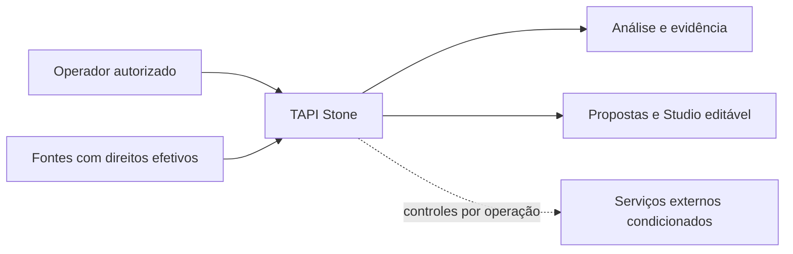

# Mapa de arquitetura — roteiro arc42/C4

Visão de navegação da arquitetura pretendida, sem declaração de implementação. Fonte: [arquitetura unificada v6.1](../base_atemporal/07_Arquitetura_Unificada_Atemporal.md), [documento mestre](../base_atemporal/01_Documento_Mestre_Atemporal.md), referências integrais incorporadas e [matriz CAP](../../planning/base_atemporal/MATRIZ_CAPACIDADES.csv).

| Perspectiva arc42 | Fonte |
|---|---|
| Objetivos, escopo, restrições | Documento mestre, DEC-018, R$0 |
| Contexto/estratégia | Arquitetura unificada, contexto editorial |
| Blocos e runtime | Arquitetura unificada e System One |
| Implantação | Arquitetura, benchmark e DEC em aberto; não afirmar stack homologada |
| Conceitos transversais | Direitos, segurança, metodologia, contratos |
| Decisões | Matriz DEC e registro |
| Qualidade e riscos | U, CAP, ISO, CT, lacunas e gates do Plano Único |
| Glossário | Documento mestre e metodologia; normalização semântica integral pendente |

## C4 — contexto conceitual (alvo, não runtime observado)

## Fluxo lógico da jornada

Os blocos são conceitos da jornada, não serviços implantados nem lista de novos componentes. Diagramas C4 de containers/componentes e runtime efetivo devem ser vinculados a versões e validados contra código; não completar por suposição. Nenhum diagrama substitui a especificação de arquitetura original.
