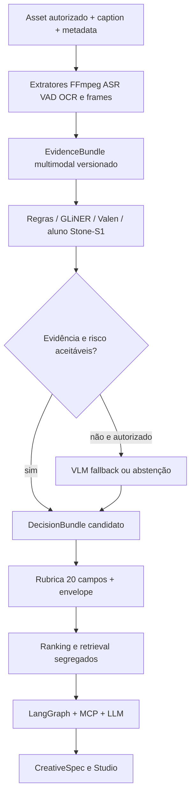

# System One e Stone-S1 — especificação experimental

**Base atemporal v6.1 — proposta documental.** Requisitos e hipóteses não são declarações de execução. Detalhes originais são parte desta base por remissão obrigatória ao mapa de seções; fatos datados ficam em `04_Snapshots/`.

## 1. Objetivo

Investigar modelos de decisão tipada para classificação multimodal de conteúdo dirigido a MPEs e roteamento de ferramentas, combinando precisão, cobertura, latência, custo local e rastreabilidade. Stone-S1 é nome provisório, não modelo treinado ou DEC aprovada. Estende DEC-017, CAP-003/005/021/022, sem novo produto ou CAP. Hipóteses do solicitante: Jev/SubQ e modelo próprio, Whisper, VLM, embeddings, BERTimbau comentários e VLM professor + aluno. System One é paradigma operacional (decisão com alternativas), não equivalência arquitetural universal. System Two é orquestração/geração aberta, não obrigatoriamente um único LLM. Jev não é JEPA; SubQ Snap é o modelo de decisão, distinto do LLM SubQ.

## 2. Baselines históricos, lacunas e candidatos

E1 `DecisionModel`, `ObservedText`, `EvidenceBundle`, `DecisionBundle`, GLiNER local (sete perguntas, hook sempre abstenção em E1), classificação candidata e provenance; E1 não agente. ASR/VAD/OCR e VLM, replay 15 braços, Evidence Lab sintético. Consultar o catálogo e o snapshot datado para contagens de captions, elegibilidade, rubrica e testes. O VLM Qwen3-VL 2B v2 teve gate reprovado no corte inicial; não promover sem nova evidência. Valen 1.5 0.8B/2B é novo candidato multimodal (ONNX CPU/GGUF custom), verificar vídeo por runtime, licença peso e dados, CPU/RAM/disco, código remoto auditado. GLiNER baseline; Laya Multilingual candidato com checkpoint a verificar. Jev/Snap somente referência documental até prova de acesso sem custo e tratamento permitido. SubQ Snap tem oferta comercial; não utilizar agora. Direitos de mídia e treinamento, disponibilidade dos dados e estado de execução devem ser conferidos no snapshot e registros operacionais.

## 3. Arquitetura e contratos propostos

PDP/PEP precedem cada ação. Inputs: tenant/content/asset, modalidades disponíveis, refs/sha256, timestamps, spans, observability mask, rights scope, schema version; não likes/comments/followers como features da rubrica. Outputs por campo: field_id, value tipado ou null, state, reason, model/revision, evidence refs e locator, probability vector se realmente disponível, confidence/calibration_status, runtime ms, policy version. Sem inventar logits ou probabilities; validar finite, normalização de choice, limites ordinais, enum e consistência CTA. Propriedades: abstenção não afirma valor; candidato não é canonical; grounding verifica evidência observada; contrato Pydantic evolui sem mudar rubrica de 20. `mpe_targeted`, intenção e contexto secundário separados. Job outputs persistidos com lineage, rights e hash; revogação invalida descendentes inclusive embeddings/datasets/checkpoints conforme política. Treinamento exige direito específico; retenção do checkpoint após revogação deve ser tratada explicitamente, não prometer unlearning.

## 4. Roteamento por atributo (candidatos, não vencedores)

| Campo | Método primário proposto | Limite |
|---|---|---|
| tipo_post | metadado | verificar formato |
| duracao_faixa | FFprobe + bins | bins documentados |
| formato_video | Valen/VLM + sequência | não só thumbnail |
| hook_primeiros_3s | ASR/OCR/frames 0–3s | texto extraído, timestamps |
| tipo_hook | classificador tipado | abertura efetivamente observada |
| forca_hook_0a10 | ordinal | âncoras e referência; sem score inventado |
| tema_principal | GLiNER/Stone-S1/Valen | legenda + modalidades |
| tem_rosto | detecção visual/Valen | sem identificação pessoal |
| criador_e_empreendedor_real | declaração/contexto documental | não inferir por aparência |
| prova_social | ASR/OCR/decisão | alegação vs fato |
| texto_na_tela | OCR/visão | presença não ausência por uma imagem |
| legenda_tamanho | caracteres + bins | medição vs categoria |
| ritmo_cortes_0a10 | análise temporal | contagem ≠ nota |
| tom | decisão textual/multimodal | prosódia, ambiguidades |
| usa_linguagem_regional | PT-BR + ASR | não inferir origem pessoal |
| clareza_mensagem_0a10 | ordinal | âncoras; abstenção |
| tem_cta | ASR/OCR/decisão | negar só se evidência suficiente |
| tipo_cta | decisão dirigida | ação e objeto co-localizados |
| oferta_ou_beneficio_explicito | ASR/OCR/decisão | explícito e grounded |
| elementos_top5 | extração + síntese | não explicação causal |

## 5. Experimentos: braços e ordem

E-S1-01: regras E1/CTA directed, GLiNER, Laya (se confirmado), Valen sobre mesma evidência textual; permutar alternativas, PT/EN, negação, ironia, múltiplas ações. E-S1-02: Valen 0.8B primeiro; comparar Qwen3-VL e OCR/regras nos mesmos frames e clipes; separar entradas (runtime de vídeo vs frames); medir shared fixtures e novos casos congelados, preservar FAIL. E-S1-03: ablação legenda, ASR, OCR, frames/visão e fusão; medir ganho por campo, timecode, risco-cobertura; não reusar dev como test. E-S1-04: piloto real apenas após direito e integração dos processadores; inicialmente pequena amostra estratificada de casos autorizados; sem admission automática, métricas de cobertura/consistência. E-S1-05: teacher/student e cascata; comparar baseline, alunos e professores em grupo held-out por criador/tempo. E-S1-06: retrieval e LangGraph; E-S1-07: intenção em comentários, condicionado.

## 6. Stone-S1 próprio e destilação

Text: TF-IDF/LogReg/SVM, embeddings E5/BERTimbau/GLiNER, cabeças por campo. Fusion: encoders congelados para texto, imagem, temporal; concatenação/fusão leve, máscara de modalidades e MLP multi-head; comparar CatBoost/LightGBM quando features tabulares justificarem. Native: adaptação LoRA/SFT Valen ou outro modelo somente após prova de viabilidade/compatibilidade. Não pré-treinar foundation model. Teacher A VLM generativo; B Valen/GLiNER, ASR/OCR/regras especialistas; nenhum professor aprovado a priori. Selecionar amostra estratificada por diversidade, incerteza, classe e tempo (active selection), preservar casos aleatórios; consenso não é independência. Armazenar pseudorrótulo, evidência, distribuição real se disponível, conflitos, máscara e versão; dados de treino/dev/test disjuntos por criador/tempo. Para hard labels usar CE; para soft labels reais KL(p_teacher || p_student)×T² e máscara por campo; não fabricar logits de JSON textual. Perda total Σ w_j m_j L_j, pesos pré-registrados. Aluno não aprende atributo que sua entrada não observa. Métricas de fidelidade ao professor separadas da qualidade real. Se professor só tem caption, não ensinar visual. Reavaliar drift e custo total inclusive extração e treino, fallback e armazenamento; promover somente se ganho e direitos. Model/dataset card, checkpoints SHA-pinned, rollback e estratégia de invalidação/retreino diante de revogação.

## 7. Busca de referências e agente

E5-small/base, BGE-M3 candidatos; baseline FTS/BM25 e busca vetorial exata local, RRF/reranking comparado. Separar texto, transcrição, evidência/metadata e embeddings visuais; filtros de tenant/rights antes da consulta e no resultado. Score de relevância separado de performance, evidência e diversidade. Citações por post/snapshot, não similaridade como prova de sucesso. LangGraph estado tipado, nós planejamento → retrieve → analytics determinístico → evidence verification → geração → validador de saída → Studio; fallback seguro, budget e checkpoints. MCP contrato único REST/Python/SDK, sem dados além do permitido; três tools do B2 como baseline histórico. Roteador System One apenas decide ferramentas/necessidade de modalidade, não concede direitos. Teste de prompt injection, citações inventadas, ausência de dados e resposta de insuficiência.

## 8. Comentários e intenção

CAP-011, IMP-067. BERTimbau Base, BERTabaporu, TF-IDF+LogReg/SVM, GLiNER zero-shot e Laya candidato. Taxonomia: contato explícito, preço, inscrição, informação, produto, participação induzida pelo CTA, relato, elogio, negativo, spam e incerto. Comentário+contexto autorizado, distinguir negação, ambiguidade e resposta a convite comunitário. Não identificar pessoas/atribuir lead individual automaticamente. Contagem de candidatos/abstenções e denominador; probabilidade média só se calibração defensável. Lead/CRM/conversão são resultados distintos indisponíveis. Requer acesso autorizado ao texto e direitos de treinamento; pseudorrótulo programático não gold. Sem dados, manter hipótese bloqueada; não coletar por scraping.

## 9. Oráculos, recursos e promoção

Pré-registrar margem de não inferioridade e ganho custo/latência; mesma evidência/hardware/versões, campos observáveis e splits congelados. Medir macro-F1/precision/recall/MAE com tipo de referência, coverage/risk, falsos positivos em negativos, grounding, WER e latência p50/p95, RAM/VRAM, espaço, energia e throughput. Gate sintético não valida real; nenhum valor de confiança calibrado sem referência. Limites de custo R$0, execução local, evitar simultaneidade de modelos, preflight armazenamento e RAM, hash/licença, isolamento. Candidatos são avaliados por evidência, não instalados por mera menção. Ordem lógica: processadores seguros e direito de dados antes de inferência real; professor e dataset antes de aluno; direito de comentários antes de treino; retrieval/agent podem evoluir em paralelo quando não violam dependências. O plano operacional atual é consultado separadamente. Toda execução mapeada a IMP existentes na matriz HIPOTESES_E_EXPERIMENTOS.csv, sem backlog separado.

## Manutenção da agenda
As sete frentes propostas pelo responsável permanecem explícitas: (i) agente de decisão System One — H5.a; (ii) modelo próprio especializado — H5.b/H5.c; (iii) ASR com grounding de gancho e CTA — H2.a; (iv) VLM e decisão visual/multimodal — H1.a/H2.a; (v) embeddings e referências — H3.a/H4.a; (vi) BERTimbau ou alternativas para intenção de contato — H-INT.a; (vii) VLM professor e classificador aluno — H5.b/H5.c. Nenhuma foi retirada; sobreposições são intencionais. A matriz de experimentos é proposta, não seleção de vencedor. A aprovação de DEC-018 não cria automaticamente direito de treinamento; dataset, derivados, modelos, indexação e retenção possuem escopos próprios.
