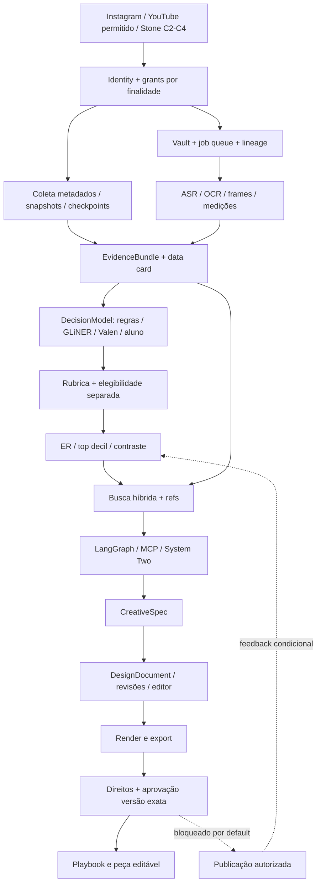

# Arquitetura unificada — as-is e to-be

**Base atemporal v6.1 — proposta documental.** Requisitos e hipóteses não são declarações de execução. Detalhes originais são parte desta base por remissão obrigatória ao mapa de seções; fatos datados ficam em `04_Snapshots/`.


## 1. Princípios e estado

Monólito modular, workers isolados, única jornada e domínio canônico, REST/Python/MCP equivalentes. Não multiplicar serviços sem benchmark. Requisitos/23 CAP/18 DEC/204 IMP, gates globais e contratos originais preservados. CAP-023 integra produção editável, não substitui núcleo. A v5.1 integral e v5.2 changelog permanecem históricos. As alterações A-01–18 são incorporadas: DesignDocument, patches, versionamento, export/render, experiência Stone/lojista, snapshots, contraste, rubrica, MCP, embaixador/collab/piloto, modelos locais, direitos, ISO/E2E, R$0 e uma única entrega.

A arquitetura-alvo é estável; a tabela as-is detalhada do corte está em `04_Snapshots/2026-11-17/consolidacao_v6/07_Arquitetura_Unificada_v6.md`. A presença de código nunca prova operação. O fluxo abaixo é o alvo, não uma fotografia do runtime.

## 2. Fluxo lógico



C1 ranking externo separado de C2/C3/C4; unir somente IDs verificados e finalidades. Política, orçamento, tracing, eventos e testes transversais. Sem auto-publicação ou paid; CRM condicionado e fora do case.

## 3. Fronteiras de domínio e contratos

16 grupos de domínio e 28 contratos candidatos / 29 inventário de schemas / 28 CT preservados nas matrizes. Entidades principais: Tenant/User/Membership/Session, Source/Grant, Creator/ContentItem, MetricsSnapshot, ingestion run/checkpoint, eligibility assessment, RubricAssessment e FieldEvidence, DatasetCard, RankingResult, Insight, EvidenceBundle, DecisionBundle, AgentRun/tool trace, CreativeBrief/Spec, DesignDocument/Revision, RenderJob/ExportArtifact/EditorialApproval, Event/Outbox; asset registry/revocation, RetainedObject, DerivedArtifact, AssetJob/Lease/Receipt/Payload. Não declarar entidade proposta implementada apenas porque contrato existe. Schemas candidatos v5.1 preservados, não homologados. REST endpoints historicamente observados no corte inicial (rever OpenAPI e grants antes de uso): /v1/auth/sessions, /v1/events e /stream, /v1/ui/overview, /v1/ingestion/runs; A6 /v1/corpus/inventory e /ranking, Studio /v1/studio/documents, Evidence Lab leitura. Para endpoints não inspecionados usar OpenAPI gerado do checkout, não inventar path. B2 MCP get_post_evidence, analyze_ranking, propose_creative_spec (valida proposta do operador, não LLM). Contrato case 3 modos/5 grupos e Pydantic; versionar erros, auth, idempotência, cursor e retenção. `DecisionBundle` novo envelope experimental, não muda JSON fixo de 20 campos.

## 4. Direitos, dados e segurança

Grants técnicos por conta e asset por operação: retrieve metadata, persist metadata, retain, process, derive, classify, aggregate, embed, train, export, publish, comments/CRM separados conforme finalidade. Ed25519 assinatura, issuer pin, revocation head/digest, janela, binding tenant/source/item/content/asset/digest/mídia, expiry/retention. AES-GCM vault, chave externa, AAD, hash e limites; lineage/tombstone e invalidação transitiva; PEP antes/durante/depois, atomicidade do job receipt e outbox. O armazenamento de derivados deve usar AEAD, chave externa, lineage e quotas lógicas por item/tenant/global; limites de implementação e migração ficam no snapshot. Purge lógico não secure erase de WAL/backups, não revoga bytes já entregues, não OS sandbox. Supervisor deve controlar árvore de processos, CPU/RAM, recuperação, chaves e issuer; consultar estado comprovado antes de uso. Não habilitar rota legada, não usar root/hash como direito. Revogação deve invalidar cache, índice, export, modelo/treino conforme contrato e direitos; lidar com backup/restore e não prometer unlearning. Segredos fora Git, criptografia, tenant, CORS/CSP, SSRF/XSS, prompt injection, audit log redigido.

## 5. Creative Studio integral

CreativeSpec ligado a evidências imutáveis; DesignDocument fonte canônica JSON editável com dimensões, páginas, layers (texto, imagem, formas, mídia), cenas/tracks, propriedades, IDs e assets direitos. Revisões imutáveis e histórico restaurável, undo/redo, autosave, ETag/controle concorrente, carrossel duplicar/reordenar/excluir, storyboard, timeline áudio/legendas/keyframes/efeitos, PNG/JPEG/SVG quando compatível, ZIP carrossel, MP4 render local, paridade preview/export, fontes e compatibilidade. Sugestões de IA como patch com schema/preview/aceitar-rejeitar; nenhum direito ou evidência alterado pelo modelo. Raster gerado não internamente editável; composição em camadas ao redor. Aprovação editorial da versão exata invalida com edição, nunca confundir com validação científica. Brand Kit Stone/lojista, templates licenciados, variants A/B, Reels/Shorts, Stories, capa e feed. Canvas nativo observado; Fabric/Konva, Lexical, Motion Canvas/FFmpeg, ComfyUI e Yjs candidatos, sem adoção obrigatória. CT-STUDIO-01–10 mantidos.

## 6. Operações, stack e integração

Baseline local histórica: Python≥3.11, FastAPI/Pydantic/SQLAlchemy/Alembic, SQLite, Argon2id, httpx, pytest/Node, FFmpeg/Pillow/Tesseract, faster-whisper, GLiNER, Qwen runtime. Dependências opcionais e checkpoints pinados; sem faturamento. To-be: PostgreSQL/PaaS/pgvector apenas sob benchmark e custo zero; frontend Vite/React/TS/TanStack/Zod candidato; OTel, DuckDB, eval store conforme necessidade; SDK MCP/FastMCP validar. Backup antes de migração, ensaio em cópia, invariantes de schema e tabelas, rollback sem destruição; nenhuma operação real sem autorização específica. G0–G6 globais separados de A00–A11. Evidências nos snapshots e matrizes.

## 7. Aceite e limites

Aceite por domínio e CAP, contratos, CT, EDD e ISO. Medir qualidade de software, validade do corpus, riscos e custo; evitar elevar CAP como concluída sem oráculos. O release completo depende de IMP-131 e G0–G6. Arquitetura proposta v6.1 não autoriza reestruturação automática, nem garante implementação de modelos novos. Fonte: v5.1/v5.2 e revisão v3, docs/33,35,51–74, [PR #43](https://github.com/pablo-marchina/stone/pull/43) e [PR #44](https://github.com/pablo-marchina/stone/pull/44).

## Anexo de especificação: Studio, entidades, endpoints e invariantes
### 6.2 Contrato canônico proposto

```text
EvidenceBundle (fonte, autorização, observabilidade, n, IC)
       ↓
CreativeBrief (objetivo, persona, hipótese, referências)
       ↓
CreativeSpec (gancho, cenas/slides, copy, CTA, marca, restrições)
       ↓
DesignDocument.v1 (páginas, camadas, assets, estilos, timeline)
       ↓  ↔ editor humano e patches de IA
DesignRevision (parent, author, ops, timestamp, hash)
       ↓
RenderJob (formato, preset, versão exata, direitos, idempotência)
       ↓
ExportArtifact (SHA-256, formato, dimensões, versão, manifesto)
       ↓
EditorialApproval → publicação/download/piloto quando autorizado
```

**Campos mínimos de `DesignDocument.v1`:** `schema_version`, `document_id`, `tenant_id`, `creative_version_id`, `canvas`, `platform_intent`, `pages[]`, `layers[]` ou `tracks[]`, `asset_refs[]`, `rights_status`, `reference_ids[]`, `approval_status`, `revision`, `created_by`, `updated_at`. Layers tipadas por união discriminada: `text`, `shape`, `image`, `vector`, `video`, `audio`, `caption`, `group`. Geometrias e tempos são validados; textos e arquivos não viram código executável. Armazenar na base documento JSONB versionado (quando Postgres implantado) ou equivalente validado no adaptador local; assets fora do JSON, com hash e controle de acesso.

**Invariantes:** `source evidence` é imutável na versão; revisão do design não altera ranking/classificação/insights originais; edição exige RBAC do tenant; snapshot da versão exata deve renderizar de forma reproduzível; aprovação não se transmite automaticamente para versão modificada; publicação requer autorização específica independente de geração/exportação.

### 6.3 Entidades propostas (não migradas)

Adicionar aos grupos existentes de planejamento/criação, mídia/prova, aprovações e experimentos: `creative_project`, `design_document`, `design_revision`, `design_asset`, `asset_rights`, `timeline_track`, `render_job`, `render_artifact`, `brand_kit`, `editorial_approval`, `creative_variant`, `creative_collaboration`, `organic_pilot`. Só criar tabelas granulares se consultas, segurança e volume justificarem; preferir documento versionado + índices adequados inicialmente. Eventos candidatos: `creative.design_generated`, `creative.revision_saved`, `creative.render_requested`, `creative.render_completed`, `creative.approved`, `creative.exported`; **não** misturar evento de render com `publication.published`.

### 6.4 Endpoints propostos (não implementados)

| API | Responsabilidade | Proteção |
|---|---|---|
| `POST /v1/studio/projects` | Criar projeto/editorial e associar brief | tenant, role, validacao |
| `POST /v1/studio/projects/{id}/generate` | Gerar CreativeSpec + documento inicial | quotas locais, referências, política IA |
| `GET /v1/studio/projects/{id}` | Carregar documento e versões | tenant, rights |
| `PATCH /v1/studio/projects/{id}/versions` | Aplicar operações estruturadas | `If-Match`/ETag, schema, revisão |
| `POST /v1/studio/projects/{id}/ai-patches` | Propor mudanças sem gravar automaticamente | revisão humana, safe operations |
| `POST /v1/studio/projects/{id}/render-jobs` | Exportação assíncrona por versão | direitos, budget, idempotência |
| `GET /v1/studio/render-jobs/{id}` | Status e artefato | tenant, expiração |
| `POST /v1/studio/projects/{id}/approve` | Aprovação de **versão exata** | papel editorial, registro |
| `POST /v1/publications` | Publicação externa separada | **desabilitado** até grant e aprovação específicos |

**Atenção:** caminhos são contratos candidatos, não descrição da API implementada.

---


As rotas deste anexo são propostas originais; a API efetiva pode ter nomes diferentes e deve ser inspecionada. Não duplicar serviço ou entidade para reproduzir caminho nominal. A arquitetura v5.1 integral §§6–17 e 24–27 continua parte obrigatória de detalhe, sobretudo Research OS, Resource Allocation Engine, modelo canônico, frontend live, evidence graph, governança adaptativa e segurança de promoção.
